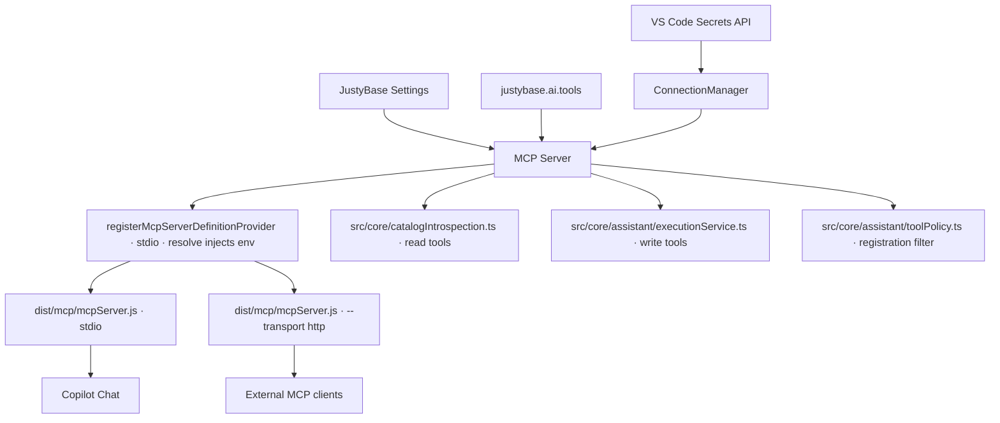

# Netezza MCP Server

The extension bundles a **Model Context Protocol (MCP)** server that exposes Netezza schema
introspection and SQL tooling to AI agents. **All assistant tools are disabled by default**; the
operator must explicitly enable a surface. Write and destructive tools additionally require the
matching profile and, for MCP, an allowlisted connection:

- **Copilot Chat in VS Code** (stdio mode) — registered via
  `vscode.lm.registerMcpServerDefinitionProvider` (`contributes.mcpServerDefinitionProviders`).
- **External MCP clients on the local machine** (HTTP mode, `127.0.0.1`) — GitHub Copilot CLI, Claude Code,
  Codex CLI, Cursor, Claude Desktop and other clients connect to `http://127.0.0.1:37210` while VS Code is open.

All MCP configuration lives in the custom **JustyBase Settings → MCP Server** section: connection selection,
on/off switches for both modes, the HTTP port, live status, tools and the OpenCode configuration snippet.
Tool access is configured in **JustyBase Settings → AI Tools** (`justybase.ai.tools`).

## What this enables

MCP turns JustyBase into a schema companion for AI-assisted SQL work. An agent can discover the right
database object, inspect its columns and DDL, search the catalog, validate SQL locally, or request a read-only
`EXPLAIN` plan. A user who explicitly grants write access can also let the agent execute DML/DDL, drop
objects, or compile NZPLSQL procedures. Defaults never allow that.

Choose the integration that matches your workflow:

- **VS Code Copilot Chat** — use the tools directly in agent mode inside VS Code.
- **External MCP clients** — enable the local HTTP server and connect tools such as GitHub Copilot CLI, Claude Code,
  Codex CLI, Cursor, Claude Desktop, or OpenCode while VS Code is running.

The selected MCP connection is explicit and independent of the active SQL editor tab. This prevents an agent
from silently switching databases when you change tabs.

## Security model

**Passwords never touch the file system.**

The MCP server is a child process of the extension host. Connection details — including the password
from the VS Code Secrets API — are injected into the process environment only:

| Layer | How credentials are provided |
|-------|------------------------------|
| stdio mode (VS Code) | `resolveMcpServerDefinition` is invoked by the editor right before start; it loads the explicitly selected connection from `ConnectionManager` and fills the `env` of the spawned process |
| HTTP mode (external clients) | the extension spawns `dist/mcp/mcpServer.js --transport http --port N` with the connection env |

No credentials file is ever written. The server exits when VS Code closes (HTTP mode is not a daemon).

## Access policy

`justybase.ai.tools` resolves an access profile per surface (`off`, `read-only`, `read-write`,
`full`) plus optional per-tool overrides. The default is `off`: no assistant tool is registered until
the operator selects a profile. Overrides can only narrow access. Read-only tools are available
after selecting `read-only`; write tools appear only when the profile allows them; destructive tools
require `full`. Selecting an override below a tool's required tier disables that tool (except
`execute_sql`, which supports a read-only reduced mode).

MCP writes have two additional gates:

- the selected connection must be listed in `writableConnections`;
- HTTP mode generates a per-run **bearer token** whenever write tools are exposed. Every HTTP request
  must send `Authorization: Bearer <token>`. The token is shown in **Settings → MCP Server** and is
  regenerated when the child process restarts.

Tools that the policy does not allow are **not registered**, so they never appear in `tools/list`.
Read tools carry `readOnlyHint: true`; write and destructive tools carry `readOnlyHint: false`, and
destructive tools additionally carry `destructiveHint: true`.

The execution layer also classifies each statement before it runs:

- `SELECT` / `WITH ... SELECT` run through `executeReader` and return capped rows;
- DML and DDL require the write tier;
- `DROP`, `TRUNCATE`, `GRANT`, `REVOKE`, `CALL` and `ALTER ... DROP` require the destructive tier and an explicit
  `confirm` value equal to the object name (for `CALL`, the procedure name).
- `compile_and_call` requires `full` and `confirm` equal to the procedure name; `compile_only` is a normal write.

Exactly one statement is accepted per call, and every call opens its own connection (autocommit, no
cross-call transaction). Database permissions remain the final boundary.

## Offered tools

| Tool | Tier | Description |
|------|------|-------------|
| `search_catalog` | read | Required `kind`: `databases`, `schemas`, `tables`, `views`, `procedures`, `external_tables`, `columns` or `all`. Optional `query`, `database` and `schema`. |
| `get_object` | read | Required `object`; optional `objectType`, `database`, `schema` and `sections` (`ddl`, `columns`, `comments`, `stats`, `constraints`, `dependencies`). |
| `explain_query` | read | Required single `SELECT` or `WITH ... SELECT` in `sql`; optional `verbose`, `analyze` and `database`. Never executes the statement. |
| `validate_sql` | read | Required `sql`; optional `mode` (`parser` or `database`) and `database`. |
| `get_reference` | read | Optional `topic` (`optimization`, `nzplsql`, `all`). Returns bundled dialect guidance. |
| `execute_sql` | write | Required `sql`; optional `maxRows`, `timeoutMs` and `database`. Destructive statements additionally require `full` and `confirm`. |
| `drop_object` | destructive | Required `object`, `objectType` and `confirm`; optional `cascade` and `database`. `DATABASE..TABLE` notation is preserved. |
| `compile_procedure` | write | Required `mode` (`compile_only` or `compile_and_call`); optional `sql` and typed `callArguments`. `compile_and_call` additionally requires `full` and `confirm` equal to the procedure name. |

The read tools reuse the shared catalog service (`src/core/catalogIntrospection.ts`). The write tools reuse
`src/core/assistant/executionService.ts`; both modules are free of `vscode` imports.

## Using it in VS Code (Copilot Chat)

1. Open *JustyBase Settings → MCP Server*, choose a saved Netezza connection and **Enable** the "Copilot Chat (VS Code)" switch.
2. In the Extensions view → MCP SERVERS → right-click **Netezza MCP Server** → **Start** (or
   `MCP: List Servers`), and confirm trust the first time.
3. The tools become available in agent mode / chat prompts.

The server uses the **selected MCP connection**, which is independent of the active editor connection. The
selected connection must remain a saved Netezza connection with accessible credentials; deletion, type changes
or lost access stop the server and require choosing another connection.

## Using it from other applications (HTTP mode)

1. In *JustyBase Settings → MCP Server*, choose a saved Netezza connection, then enable "Local HTTP Server" and choose a port (default `37210`).
2. Add the server to the client of your choice. All examples below assume the default port:

   **GitHub Copilot CLI** — add it from the terminal:

   ```bash
   copilot mcp add --transport http netezza-schema http://127.0.0.1:37210
   ```

   Alternatively, add this entry to `~/.copilot/mcp-config.json`:

   ```json
   {
     "mcpServers": {
       "netezza-schema": {
         "type": "http",
         "url": "http://127.0.0.1:37210",
         "tools": ["*"]
       }
     }
   }
   ```

   **Claude Code** — add it from the terminal:

   ```bash
   claude mcp add --transport http netezza-schema http://127.0.0.1:37210
   ```

   **Codex CLI** — add it from the terminal:

   ```bash
   codex mcp add netezza-schema --url http://127.0.0.1:37210
   ```

   The same server can be configured in `~/.codex/config.toml`:

   ```toml
   [mcp_servers.netezza-schema]
   url = "http://127.0.0.1:37210"
   enabled = true
   ```

   **OpenCode** — use its `mcp` configuration section and the Streamable HTTP `remote` transport:

   ```json
   {
     "mcp": {
       "netezza-schema": {
         "type": "remote",
         "url": "http://127.0.0.1:37210"
       }
    }
   }
   ```

   In each client, start a new session after adding the server and check its MCP server list/status if
   the tools do not appear immediately.

   When write tools are enabled, add the bearer token from **Settings → MCP Server** as an
   `Authorization` header. The OpenCode snippet in Settings already includes it. Other clients accept the
   same header via their HTTP MCP configuration:

   ```json
   {
     "mcp": {
       "netezza-schema": {
         "type": "remote",
         "url": "http://127.0.0.1:37210",
         "headers": { "Authorization": "Bearer <token from Settings>" }
       }
     }
   }
   ```

Requirements and limits:

- the server runs **only while VS Code is open** (child process; no daemon, no credentials file),
- bound to `127.0.0.1` only,
- the listener is reachable by other processes of the same user,
- all assistant tools are disabled by default; enabling a profile is an explicit operator action,
- write tools additionally require the profile, the connection allowlist and (for HTTP) the token,
- changing the selected MCP connection restarts the HTTP child process on the new target,
- changing the active editor connection has no effect on MCP.

## Configuration

`justybase.ai.tools` — per-surface profiles (`copilot`, `mcp`, `mcpExternal`), per-tool overrides and
`writableConnections` (configured in **Settings → AI Tools**; every surface is `off` by default)

`justybase.mcp.enabled` — register the stdio server for Copilot Chat (default `false`)
`justybase.mcp.connectionName` — name of the explicitly selected saved Netezza connection (default empty; no automatic fallback)
`justybase.mcp.externalEnabled` — start the HTTP server on 127.0.0.1 (default `false`)
`justybase.mcp.port` — HTTP port, `1024`–`65535` (default `37210`)

## Architecture



Shared logic lives in `src/core/assistant/` (`toolCatalog`, `toolPolicy`, `sqlAccess`, `executionService`)
and `src/core/catalogIntrospection.ts`; none of these import `vscode`, so they work both in the extension
host and in the standalone server process. The server entry point is `src/mcp/mcpServerEntry.ts` (built to
`dist/mcp/mcpServer.js` by `esbuild.js`).

## Live verification

Run `npm run test:mcp:live` with `NZ_DEV_PASSWORD` and optional `NZ_DEV_HOST`, `NZ_DEV_PORT`,
`NZ_DEV_DATABASE` and `NZ_DEV_USER`. The suite performs a preflight, opts into the read-only profile and verifies
that `tools/list` exposes only the read-only tools, calls each read tool through stdio and Streamable HTTP, compares
catalog responses with independent `_V_*` oracle queries, checks invalid arguments and process shutdown,
and writes a redacted summary to `/tmp/justybase-mcp-live-report.json`.
Fixture DDL is disabled by default; enable it explicitly with `MCP_LIVE_ALLOW_FIXTURE_DDL=1` and, if
needed, set `MCP_LIVE_FIXTURE_SCHEMA` to a schema where the test user may create temporary objects.
