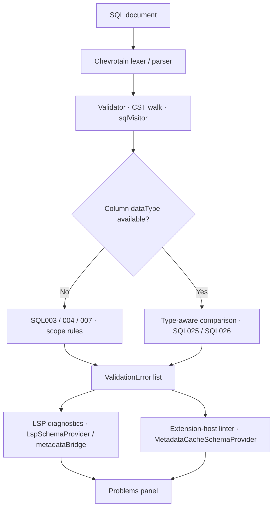

# SQL Linter

The maintained user-facing guide is [SQL quality and diagnostics](https://justybase.github.io/justybase-vscode/guide/user/sql-quality/). This file remains the implementation-oriented rule reference.

JustyBase includes a built-in SQL linter that provides real-time feedback on common SQL anti-patterns and potential issues specific to Netezza.

Bulk quick-fix policy and `Fix all` eligibility are documented in [QUICK_FIX_MATRIX.md](QUICK_FIX_MATRIX.md).



## Configuration

Enable/disable the linter and customize rule severity in VS Code settings:

```json
{
  "netezza.linter.enabled": true,
  "netezza.linter.mode": "advanced",
  "netezza.linter.rules": {
    "NZ001": "warning",
    "NZ002": "error",
    "NZ007": "off"
  }
}
```

**Mode:**
- `advanced` (default): parser-based SQL/NZPLSQL validation diagnostics.

**Severity levels:** `error`, `warning`, `information`, `hint`, `off`

## Available Rules

| Rule | Default | Description |
|------|---------|-------------|
| **NZ001** | Warning | `SELECT *` usage - recommend explicit column names |
| **NZ002** | Error | `DELETE` without `WHERE` clause |
| **NZ003** | Error | `UPDATE` without `WHERE` clause |
| **NZ004** | Warning | `CROSS JOIN` detected - Cartesian product warning |
| **NZ005** | Hint | Leading wildcard `LIKE '%...'` prevents index usage |
| **NZ006** | Info | `ORDER BY` without `LIMIT` on large result sets |
| **NZ007** | Information | Inconsistent keyword casing (mixed UPPER/lower) |
| **NZ008** | Warning | `TRUNCATE` statement - data loss warning |
| **NZ009** | Hint | Multiple `OR` conditions - consider `UNION` |
| **NZ010** | Info | Missing table alias in `JOIN` |
| **NZ011** | Warning | `CREATE TABLE AS SELECT` missing `DISTRIBUTE ON` |
| **NZ012** | Error | `UPDATE table AS alias` - AS keyword not allowed in Netezza UPDATE |
| **NZ013** | Info | `UNION` instead of `UNION ALL` - performance consideration |

Parser-owned structural diagnostics supersede their legacy NZ rule IDs in active linting:

| Legacy Rule | Parser Code | Description |
|-------------|-------------|-------------|
| **NZ002** | **SQL043** | `DELETE` without `WHERE` |
| **NZ003** | **SQL044** | `UPDATE` without `WHERE` |
| **NZ011** | **SQL045** | CTAS missing explicit `DISTRIBUTE ON` |
| **NZ012** | **SQL046** | Unsupported `AS` in `UPDATE ... AS alias` |
| **NZ019** | **PAR005** / **SQL041** | `CASE` without matching `END` |
| **NZ021** | **PAR002** | Consecutive commas |
| **NZ022** | **SQL042** | `WHERE` without `FROM` |

## Examples

### NZ002 - DELETE without WHERE
```sql
-- ❌ Error: Will delete all rows
DELETE FROM customers;

-- ✅ OK: Has WHERE clause
DELETE FROM customers WHERE status = 'inactive';
```

### NZ005 - Leading Wildcard LIKE
```sql
-- ⚠️ Hint: Cannot use index
SELECT * FROM products WHERE name LIKE '%widget';

-- ✅ Better: Index can be used
SELECT * FROM products WHERE name LIKE 'widget%';
```

### NZ007 - Inconsistent Casing
```sql
-- ⚠️ Warning: Mixed case keywords
SELECT col1 from table1 WHERE id = 1;

-- ✅ Consistent: All uppercase
SELECT col1 FROM table1 WHERE id = 1;
```

### NZ011 - CTAS Missing Distribution
```sql
-- ⚠️ Warning: Missing distribution
CREATE TABLE copy_t AS SELECT * FROM original;

-- ✅ OK: Explicit distribution
CREATE TABLE copy_t AS SELECT * FROM original DISTRIBUTE ON RANDOM;
```

### NZ012 - UPDATE with AS Alias
```sql
-- ❌ Error: AS keyword not allowed in Netezza UPDATE
UPDATE customers AS c SET c.status = 'inactive';

-- ✅ OK: Alias without AS
UPDATE customers c SET c.status = 'inactive';
```

### SQL011 - Unknown Function
```sql
-- ❌ Error: Function 'nonexistent_func' does not exist
SELECT nonexistent_func(col1) FROM mytable;

-- ✅ OK: GROUP_CONCAT is a known Netezza aggregate function
SELECT GROUP_CONCAT(name) FROM employees;

-- ✅ OK: GROUP_CONCAT_SORT sorts values before concatenation
SELECT GROUP_CONCAT_SORT(name SEPARATOR ', ') FROM employees;

-- ✅ OK: GROUP_CONCAT with ORDER BY
SELECT GROUP_CONCAT(name ORDER BY name) FROM employees;
```

### NZ013 - UNION vs UNION ALL
```sql
-- ⚠️ Info: UNION performs implicit DISTINCT (slower)
SELECT id FROM table1 UNION SELECT id FROM table2;

-- ✅ Better: Use UNION ALL if duplicates don't matter
SELECT id FROM table1 UNION ALL SELECT id FROM table2;
```

## Smart Detection

The linter correctly ignores patterns inside:
- String literals (`'SELECT * FROM ...'`)
- Line comments (`-- SELECT * is bad`)
- Block comments (`/* DELETE FROM table */`)

---

## Advanced Mode Diagnostics (Parser-Based)

When `netezza.linter.mode` is set to `"advanced"` (default), the linter uses a full SQL parser to provide semantic validation. The following diagnostic codes are available:

### Error Codes

| Code | Severity | Description | Example |
|------|----------|-------------|---------|
| **SQL003** | Error | Unknown relation (table/CTE not found) | `SELECT * FROM nonexistent_table` |
| **SQL004** | Error | Unknown column (column not found in scope) | `SELECT fake_column FROM employees` |
| **SQL006** | Error | No relation found for qualified name | `SELECT t.column FROM employees e` (t not in scope) |
| **SQL007** | Error | Invalid DB.TABLE format (use DB..TABLE) | `SELECT * FROM mydb.mytable` (should be `mydb..mytable`) |
| **SQL008** | Error | Ambiguous column reference | `SELECT department_id FROM employees JOIN departments USING(id)` |
| **SQL010** | Error | Non-boolean expression in WHERE/ON/HAVING | `WHERE 1 + 2` (should be comparison) |
| **SQL011** | Error | Unknown function | `SELECT nonexistent_func()` |
| **SQL012** | Warning | VARCHAR without length | `CREATE TABLE t (name VARCHAR)` (should specify length) |
| **SQL013** | Error | Unknown data type | `CREATE TABLE t (col fakedtype)` |
| **SQL014** | Error | Invalid type parameters | `CREATE TABLE t (id INT(10))` (INT doesn't take params) |
| **SQL016** | Error | Unknown external table option | `CREATE EXTERNAL TABLE ... USING (UNKNOWN_OPTION 'value')` |
| **SQL017** | Error | Invalid external table option value | `CREATE EXTERNAL TABLE ... USING (MAXERRORS 'not_a_number')` |
| **SQL018** | Warning | Unused CTE definition | `WITH cte AS (...) SELECT 1` |
| **SQL019** | Warning | Unused table alias | `SELECT * FROM my_table t` (without `t.` usage) |
| **SQL020** | Error | Subquery in FROM/JOIN requires alias | `SELECT * FROM (SELECT 1)` |
| **SQL051** | Warning | CROSS JOIN produces a Cartesian product | `SELECT * FROM a CROSS JOIN b` |
| **SQL052** | Information | JOIN source has no alias | `... JOIN departments ON ...` |
| **SQL053** | Warning | JOIN comparison uses a string literal with a column | `... ON a.id = '1'` |
| **SQL047** | Error | Invalid ordered-set aggregate (`PERCENTILE_CONT`/`PERCENTILE_DISC` missing `WITHIN GROUP` or combined with `OVER`) | `SELECT percentile_cont(0.4) FROM t` |
| **SQL049** | Warning | Repeated projected column name requires an alias | `SELECT * FROM a JOIN b ON 1=1` when both sources contain `ID` |

### Syntax Error Codes

| Code | Severity | Description |
|------|----------|-------------|
| **LEX001** | Error | Lexer error (invalid token, unclosed string) |
| **PAR001** | Error | Parser error (syntax error, unexpected token) |

### Quick Fixes

Some diagnostic codes include automatic Quick Fixes:

| Code | Quick Fix Action |
|------|-----------------|
| **SQL007** | Convert `DB.TABLE` to `DB..TABLE` (Netezza syntax) |
| **SQL004** | Replace an unknown column with an unambiguous visible-column suggestion |
| **SQL008** | Qualify ambiguous column with table alias (e.g. `a.id`) |
| **SQL051** | Replace an unqualified `CROSS JOIN` with `INNER JOIN ON 1=1` for review |
| **SQL052** | Add a generated JOIN alias and update unambiguous table references |
| **SQL012** | Add default VARCHAR length `(100)` |
| **NZ007** | Normalize inconsistent SQL keyword casing |
| **NZ010** | Add missing table alias in `FROM`/`JOIN` |
| **NZ011** | Add `DISTRIBUTE ON RANDOM` to CTAS |
| **NZ012** | Remove unsupported `AS` keyword from `UPDATE ... AS alias` |
| **NZP012** | Normalize the accepted synonym `ELSEIF` to `ELSIF` (`ELSE IF` is a valid nested IF and is left alone) |

Guided **parameterized template** quick fixes are also available for high-impact unsafe diagnostics
(`NZ002`, `NZ003`, `NZ004`, `NZ011`, `NZ015`, `NZ020`, `NZP001`, `NZP002`, `NZP003`,
`NZP011`, `NZP013`, `NZP024`, `NZP027`, `NZP028`) so you can apply scaffolded rewrites with placeholders and preview.

Procedure linting uses a conservative automatic profile. Parser/CST diagnostics and high-confidence
procedure contract checks run automatically; style and heuristic NZP rules such as missing exception
handler, naming conventions, transaction-control advice, missing `EXECUTE AS`, and VARRAY advice are
available only in on-demand linting.

### Large scripts and forced parser validation

Automatic diagnostics are intentionally skipped for very large scripts:

- the SQL language server publishes parser diagnostics up to `400,000` characters or `10,000` lines;
- the extension-host linter skips automatic quality lint above `500` lines or `150,000` characters while the LSP is running.

The LSP limits are deliberately separate from `LARGE_SCRIPT_CHAR_THRESHOLD` (`150,000`), which still
guards expensive extension-host features such as the parser-backed semantic-token path, decorations,
and code lens. The language server runs in its own process and can afford a larger document.

`Validate SQL (Chevrotain Parser)` is the explicit override. It validates the whole document (or the
current selection) in the extension host and publishes the findings to the Problems panel under
`Netezza Parser (on demand)` (or `Netezza Parser (selection)` for a partial selection). The command
shows a progress notification while the synchronous parse is running; a 10k-line script blocks the
extension host for roughly 0.15-0.2 s, while much larger scripts can still take noticeably longer,
which is why this path is never used automatically.

`Lint SQL (On-Demand)` remains the separate command for NZ/NZP quality rules. Procedure fallback
parsing is cached for one quality-rule evaluation so a procedure is not parsed once per migrated NZP
rule.

Local benchmark results (`npm run benchmark:parser`) for a realistic NZPLSQL procedure and
alias-heavy SELECT scripts. The benchmark runs the compiled `packages/sql-core/dist` bundle in plain
Node; the earlier Jest-based numbers were replaced because ts-jest/Babel transformation inflated them
by roughly 4-5x:

| Fixture | Before optimizations | Current | Improvement |
|---|---:|---:|---:|
| 3k procedure / 84k chars | ~153 ms | ~36 ms | ~76% |
| 5k procedure / 140k chars | ~197 ms | ~49 ms | ~75% |
| 10k procedure / 281k chars | ~389 ms | ~88 ms | ~77% |
| 15k procedure / 422k chars | ~588 ms | ~121 ms | ~79% |
| 5k SELECT with aliases / 254k chars | ~1,240 ms | ~311 ms | ~75% |
| 10k SELECT with aliases / 509k chars | ~4,020 ms | ~650 ms | ~84% |

The first hot path was PAR004 keyword-typo detection: a full Levenshtein DP matrix was built for every
identifier and every clause keyword, which accounted for about 49% of validation CPU. It now uses a
linear single-edit check plus a per-validation cache, so the typo scan costs well under 1 ms.

The next, larger hot path was the unused-symbol collector (SQL018/SQL019). It grouped occurrences with
`definitions.map(definition => occurrences.filter(...))`, which is quadratic for scripts with many
aliases or CTEs. Grouping occurrences by `symbolId` in one pass reduced the 10k-SELECT case from
~4.0 s to ~0.65 s. The validator also skips the collector when the token stream contains no
`WITH`/`FROM`/`JOIN`/`UPDATE`/`DELETE`/`MERGE`, and the CST walkers no longer allocate temporary
`Object.values`/`Object.entries` arrays or a default `Set` per call. The Netezza parser now caches its
identifier OR-alternatives instead of rebuilding them on every rule invocation, and the macro
sanitizer returns immediately when the SQL contains no `%`, `&`, or `$`.

Full LSP diagnostics pipeline (`npm run benchmark:lsp-pipeline`). It runs the real diagnostics handler,
metadata bridge, parse/validation sessions, incremental validation, statement indexing, and
diagnostics conversion; only JSON-RPC transport and metadata I/O are stubbed. Times exclude the 2 s
large-script debounce and are medians from the local benchmark run:

| Fixture | Cold first validation | Warm edit |
|---|---:|---:|
| 3k procedure / 84k chars | ~59 ms | ~45 ms |
| 5k procedure / 140k chars | ~67 ms | ~74 ms |
| 10k procedure / 281k chars | ~140 ms | ~148 ms |
| 15k procedure / 422k chars | ~215 ms | ~251 ms |
| 20k procedure / 563k chars | ~290 ms | ~296 ms |
| 5k short INSERT statements / 184k chars | ~149 ms | ~135 ms |
| 10k short INSERT statements / 369k chars | ~271 ms | ~315 ms |
| 5k SELECT with aliases / 254k chars | ~493 ms | ~508 ms |
| 10k SELECT with aliases / 509k chars | ~973 ms | ~873 ms |

A real `dist/server/main.js` process confirmed the harness at the boundary: after the 2 s debounce,
a 10k-line procedure published diagnostics in about 0.3 s wall time (the handler timer was ~0.26 s in
the pre-optimization run), while a 15k-line document was short-circuited with an empty diagnostic
list.

The 10k procedure now takes about 0.14 s, 10k short statements about 0.27 s, and a 5k alias-heavy
SELECT script about 0.49 s. All stay well below a 1 s budget even with slower machines. The 10k
alias-heavy SELECT fixture is 509k characters, above the 400k LSP limit, and is included only through
the benchmark override; it still completes in about 0.97 s. Based on these measurements the automatic
LSP limits were raised from `150,000` characters / `3,000` lines to `400,000` characters / `10,000`
lines. 15k+ scripts remain on the explicit `Validate SQL` path for headroom: a slower laptop or a cold
metadata cache can multiply the measured times, and the language server serves completion/hover from
the same event loop. The extension-host guard remains at `150,000` characters / `500` lines, so the
larger LSP window does not turn on the expensive extension-host features.

The warm row is not much faster than cold because the procedure fixtures are one large
`CREATE PROCEDURE` statement: any edit invalidates the whole statement. Multi-statement fixtures also
show little incremental win because statement indexing still scans the document. That is the
realistic worst case for large Netezza scripts. Scripts above the defaults should still use the
explicit `Validate SQL` command.

### Parser-Based Symbol Rename

The advanced parser model also powers SQL **Rename Symbol** (`F2`) for local SQL symbols:

- **CTE names** (`WITH cte_name AS (...)`) — definition and in-scope references
- **Table aliases** (`FROM table_name t`) — alias declaration and qualifier references (`t.column`)
- **Tables created in script** (`CREATE TABLE ...` / `CREATE TEMP TABLE ...`) — definition plus references across the whole SQL document

Rename for CTE and aliases is scoped to the current SQL statement fragment, while created tables are renamed across the document.

### Parser-Based Navigation and Autocomplete

Parser mode also powers:

- **Go to Definition** (`F12`)
- **Find References** (`Shift+F12`)
- **SQL autocomplete** for local symbols (CTE/temp table columns, aliases) and metadata-qualified paths (`DB.`, `DB..`, `DB.SCHEMA.`)
- Target-aware DDL/DML completion:
  - `DROP VIEW` suggests **only views** (view icon),
  - `DROP PROCEDURE` suggests cached procedure signatures,
  - `UPDATE` / `DROP TABLE` / `TRUNCATE TABLE` suggest table targets.
- **Scope-aware semantic autocomplete** in expression contexts (`SELECT/WHERE/ON/...`) with valid in-scope columns and SQL function suggestions

### Parser Flow Analysis API

For parser-driven script analysis and refactoring assistants, `sqlParser` now exposes `analyzeSqlScriptFlow(sql)` which returns:

- lineage edges for parser-known created tables across statements (e.g. `CREATE TEMP TABLE` → later `SELECT` / `DROP`),
- unused symbol candidates (CTE/alias),
- inline-CTE refactor candidates for single-use CTEs.

Navigation and autocomplete are parser-based.

### Examples

#### SQL003 - Unknown Relation
```sql
-- Error: Table 'nonexistent_table' does not exist
SELECT * FROM nonexistent_table;

-- OK: Table exists in schema
SELECT * FROM employees;
```

#### SQL004 - Unknown Column
```sql
-- Error: Column 'fake_column' not found in 'employees'
SELECT fake_column FROM employees;

-- OK: Column exists
SELECT first_name FROM employees;
```

#### SQL007 - Invalid DB.TABLE Format
```sql
-- Error: Netezza uses DB..TABLE (double dot) for schema-default
SELECT * FROM mydb.mytable;

-- OK: Correct Netezza syntax
SELECT * FROM mydb..mytable;

-- OK: Fully qualified
SELECT * FROM mydb.myschema.mytable;
```

#### SQL008 - Ambiguous Column
```sql
-- Error: 'department_id' exists in both tables
SELECT department_id 
FROM employees e 
JOIN departments d ON e.department_id = d.department_id;

-- OK: Qualify the column
SELECT e.department_id 
FROM employees e 
JOIN departments d ON e.department_id = d.department_id;
```

#### SQL012 - VARCHAR Without Length
```sql
-- Warning: VARCHAR should specify length
CREATE TABLE t (name VARCHAR);

-- OK: Explicit length
CREATE TABLE t (name VARCHAR(100));
```

### NZPLSQL Validation

The parser also validates stored procedures (NZPLSQL):

- Variable type validation (`INT4`, `VARCHAR(n)`, `NUMERIC(p,s)`, etc.)
- Unknown function detection in procedure body
- Invalid data type detection in `DECLARE` section
- Control flow validation (IF/END IF, LOOP/END LOOP, etc.)
