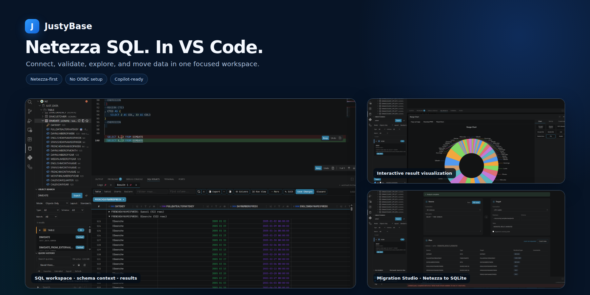
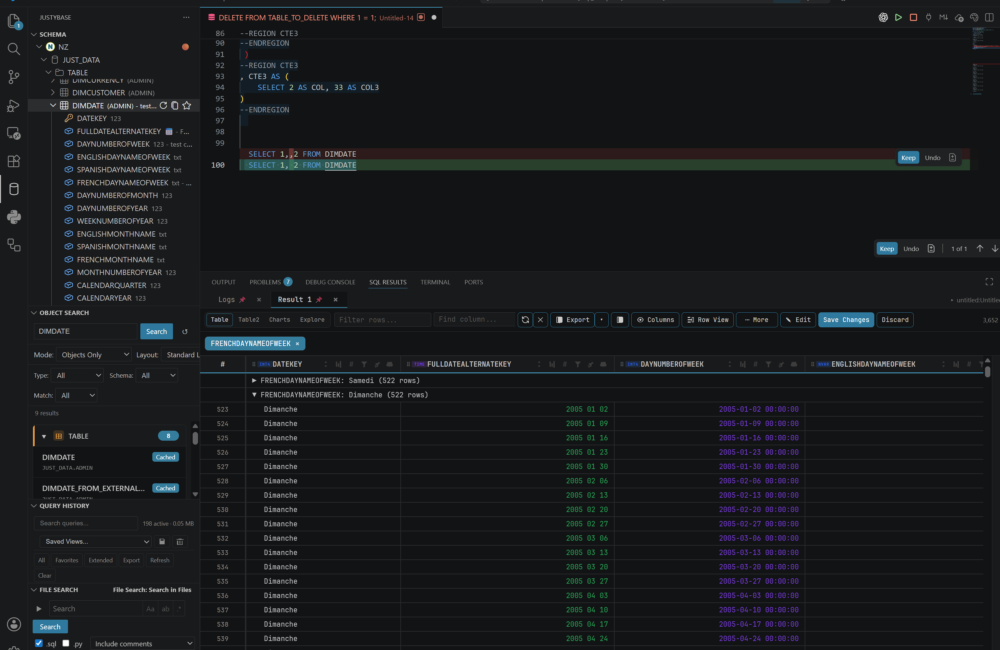

# JustyBase SQL Editor for Microsoft Access

Read the [JustyBase documentation portal](https://justybase.github.io/justybase-vscode/guide/), including the [Access capability matrix](https://justybase.github.io/justybase-vscode/guide/reference/database-support/) and [Data Workspace guide](https://justybase.github.io/justybase-vscode/guide/user/data-workspace/).



**Open, query, inspect, and carefully edit `.mdb` and `.accdb` files directly in VS Code.**

The Access companion brings local Microsoft Access files into [JustyBase SQL Editor](../../README.md). The core extension is installed automatically; Netezza, ODBC, Java, and an external database server are not required.


## A practical Access-to-SQL workflow



Select a local file, browse tables and saved queries, write SQL, and inspect the result without leaving VS Code. The reader decodes the file in TypeScript and queries an embedded DuckDB mirror.

## Highlights

- Read Jet 3, Jet 4, and ACE `.mdb` / `.accdb` files through the native TypeScript reader.
- Browse ordinary tables, columns, table metadata, and non-parameterized saved `SELECT` QueryDefs.
- Run `SELECT` queries and use the shared completion, diagnostics, result grid, filtering, profiling, and export tools.
- Optional staged editing for ordinary-table `INSERT`, `UPDATE`, and `DELETE` operations.
- Supported native DDL: `CREATE TABLE`, `DROP TABLE`, `CREATE INDEX`, `DROP INDEX`, `CREATE VIEW`, `DROP VIEW`, `ALTER TABLE ADD/DROP CONSTRAINT`, and `TRUNCATE TABLE`. `CREATE TABLE` accepts `NOT NULL` and Access `DEFAULT` expressions.
- Access' own SQL window rejects `DEFAULT` in `CREATE TABLE` (verified against DAO 16). The extension's DDL engine accepts it and stores the value in the column property map, which is where Access keeps defaults; exported DDL that contains `DEFAULT` therefore replays inside JustyBase, not in Access' query designer.
- Browse table keys and indexes in the schema tree.
- Preserve required values, column `DefaultValue` expressions, `AllowZeroLength`, validation rules and index uniqueness while writing; updated files are installed atomically.
- New tables store `Required`, `DefaultValue`, `AllowZeroLength` and `ValidationRule`/`ValidationText` in the Access property map, so Access and DAO apply the same defaults and rules as the SQL mirror.
- The SQL mirror translates the column and record validation rules Access evaluates (`>0`, `Between … And …`, `Is Null Or …`, `Not (…)`, `In (…)`, comparisons and casts) into `CHECK` constraints, so a query that would fail in Access also fails in the editor. Rules outside that subset — `Like`, `Len`, `DLookup` or another table's field — are preserved in the file but not enforced by the mirror.
- Keys and relationships are mirrored too: a primary key or unique index rejects the same duplicates Access rejects (text keys compare ignoring case and trailing spaces, `NULL` keys stay duplicated), `WITH DISALLOW NULL` columns reject `NULL`, and an enforced relationship rejects an orphan child row or a parent delete that is still referenced.
- `SELECT * FROM _access_metadata.mirror_warnings` lists every constraint the mirror had to drop or relax for the open file.
- No Java runtime, JAR, ODBC driver, Maven build, or Access installation is needed.

### Explore data visually


Profile columns, check nulls and distinct values, filter and sort rows, export to common formats, or turn a result into a chart.


### Completion and saved queries

Access connections use the shared SQL editor, completion, result grid, filtering, profiling, and export tools. Saved non-parameterized `SELECT` QueryDefs appear as views; other query types remain read-only metadata.

## Open an Access file

1. Install **JustyBase SQL Editor (Microsoft Access)**.
2. Open **Connect to Database** from the JustyBase view.
3. Choose **Microsoft Access**, select an `.mdb` or `.accdb`, and optionally enter its password.
4. Keep **Open database as read-only** enabled for inspection. Disable it only for the supported write/DDL subset.
5. Save and connect, or right-click the file in Explorer and choose **Save Access File as Connection**.

The optional password is stored in VS Code Secret Storage. The source file is not uploaded or copied into the repository.

## Locks and recovery

Writable connections create the same lock file Microsoft Access uses (`.ldb` for
MDB, `.laccdb` for ACCDB) and hold it open while the connection is active. The
companion also writes `<database>.justybase-lock.json` next to the file with the
owning process ID, host, and start time.

- A lock left by a crashed JustyBase process on the same machine is reclaimed on
  the next writable connect.
- A lock held by Microsoft Access, another machine, or an unknown process is
  never removed automatically. When no Access window is open, run
  **JustyBase Access: Clear Stale Lock File** from the Command Palette or the
  Explorer context menu of the `.mdb`/`.accdb` file. The command refuses to
  remove a lock that the operating system still reports as open.
- If a staged write cannot be installed or restored, the error names the
  preserved `.bak` file. Move it back into place after closing the process that
  holds the database.
- Password-protected files remain read-only, and the error explains why.

## Important boundaries

- Parameterized, crosstab/PIVOT, action, pass-through, and Access-only saved queries remain read-only metadata.
- Jet 3 row writes are supported; Jet 3 DDL is refused with an explicit error (the DDL engine targets Jet 4/ACE layouts).
- Password-protected files are read-only in this release: the reader decrypts pages in memory, but the staged writer mutates raw pages, so writes to encrypted files are refused to protect the database.
- Schema changes do not cover `ALTER TABLE ADD/DROP COLUMN`, `CREATE TABLE AS SELECT`, calculated fields, or complex/multivalue column writes.
- Column defaults from the source file are applied by the SQL mirror for literals and a few zero-argument date functions; Access-only expressions (`DLookup`, field references) are preserved in the file but not evaluated inside the mirror.
- Validation rules are enforced by the mirror only for the translatable subset; a rule that cannot be translated, or legacy rows that already violate a stored rule, downgrade the table to an unconstrained mirror (the mirror records the reason in `warnings`) instead of blocking the file.
- Keys and foreign keys are advisory in the same way: a `MEMO`/`OLE` index, a self-referencing or cyclic relationship, a text key DuckDB cannot point a foreign key at, or legacy rows that already break a key drop just that constraint and record why. A cascading relationship keeps its key but not its cascade, so a parent delete or key update Access would cascade is refused rather than writing orphan children.
- `SELECT * FROM _access_metadata.mirror_warnings` lists every mirror constraint that was dropped or relaxed for the open file.
- Access' DDL grammar has no `CHECK` syntax (DAO 16 and the C# UCanAccess port both reject it), so `ValidationRule`, `ValidationText` and `AllowZeroLength` survive through the property map and are not emitted in generated DDL.
- `TRUNCATE TABLE` deletes every row but does not reset an AutoNumber seed.
- Multi-file source editing is not part of Access support; export query results when you need a separate file.

## Runtime and development

The platform-specific VSIX includes the locked native DuckDB runtime for Windows x64, Linux x64, or macOS arm64. No Java bridge is packaged.

```bash
npm run install:access
npm run check-types:access
npm run build:access
npm run test:access:read-parity  # all fixtures compared with Jackcess (JDK 11+)
npm run test:access:csharp-ddl   # generated DDL replayed by the C# UCanAccess port (.NET 10+)
```

The read-parity gate compares every shipped fixture table, column, index, cell
value, Access `Required` property and `DefaultValue` expression with
[Jackcess](https://jackcess.sourceforge.io/), while
`scripts/access-java-crosscheck.cjs` verifies that Jackcess can read a file
written by the TypeScript writer. The C# replay recreates each fixture schema
from the extension's generated `CREATE TABLE` statements and verifies that
Access `Required` columns keep their `NOT NULL` flag and `DefaultValue`
expressions replay unchanged. The read-parity gate builds
`packages/access-file` first on a clean checkout; the C# replay instead resolves
`@justybase/access-file` to the package sources, so it runs straight after
`npm ci` without a prebuilt `dist/`. On Windows with Microsoft Access installed,
`npm run test:access:com` and `npm run test:access:sql` additionally compare
metadata, writes and query semantics with DAO (set `ACCESS_COM_VALIDATE=1`),
including the DAO `Required`/`DefaultValue`/`AllowZeroLength` field properties
and the validation rule/rule message pair Access reports. The DAO gate also
drives the same `INSERT` values through Access and the SQL mirror and asserts
that both reach the same accept/reject verdict, including the text-key case and
trailing-space rules, duplicate `NULL` keys, `WITH DISALLOW NULL` indexes,
numeric and text foreign keys, orphan child rows and referenced parent deletes,
and that a table written by the TypeScript writer enforces its stored rule and
`AllowZeroLength=False`
inside Access itself. Written files can also be cross-checked with the
optional readers in `tools/access-ddl-compare` and `tools/access-java-verify`.

## License

Apache-2.0. The Marketplace VSIX includes `THIRD_PARTY_NOTICES.md`.
